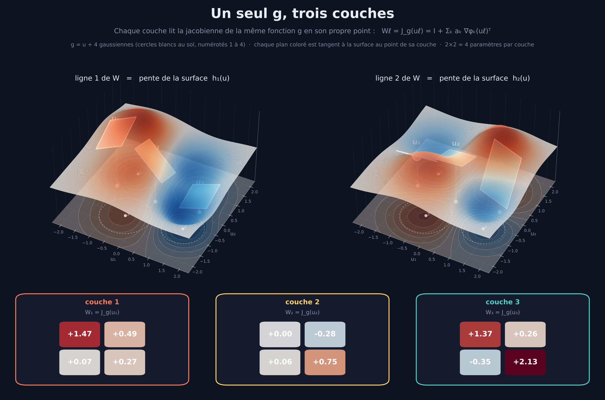

# Générateur jacobien — entraîner des matrices comme jacobiennes d'une fonction

**Clôturé le 2026-10-24 · résultat négatif nuancé, confirmé par la Phase 5 (professeur jacobien)** · NumPy pur (`src/`) + PyTorch pour le test d'échelle (`scale/`) · 11 tests (`tests/`)



*Un seul g = u + 4 gaussiennes, lu en trois points : chaque couche récupère sa matrice 2×2 (4 paramètres) comme jacobienne de g en son point. Chaque plan coloré est tangent à la surface hᵢ(u) = gᵢ(u) − uᵢ au point de la couche : la ligne i de Wℓ est exactement sa pente. Les trois plans appartiennent à la même surface, donc ils ne sont pas libres entre eux — c'est cela, l'intégrabilité. (`python src/figure_3d.py`)*

## Le point de départ, et où il a mené

L'idée de départ était simple : entraîner une matrice de poids non pas coefficient par coefficient, mais comme si elle était **la jacobienne d'une fonction g** (ici g(u) = u + Σₖ aₖ φₖ(u), avec des gaussiennes φₖ), puis entraîner g à la place.

Le premier prototype évaluait g en **un seul point** — et il est vite apparu qu'il n'y avait rien à en tirer : n'importe quelle matrice est la jacobienne de quelque chose (g(u) = Wu suffit), et avec K gaussiennes on obtient W = I + ABᵀ, une perturbation de rang ≤ K, autrement dit **une LoRA reparamétrée** (Hu et al., 2021). La Phase 1 le confirme : l'écart sur des cibles quelconques est exactement celui d'une LoRA de rang 1, et l'optimisation est même *moins* robuste (88–93 % de convergence contre 100 %).

L'idée ne tient donc que si **un même g est évalué en plusieurs points** u₁…u_m. Les matrices W(uᵢ) = J_g(uᵢ) forment alors un champ relié par la continuité de g, champ qui doit vérifier la condition d'**intégrabilité** (∂ₗ Wⱼₖ = ∂ₖ Wⱼₗ) — une contrainte que ni LoRA ni un hypernetwork à sortie libre n'imposent. Concrètement, toutes les matrices du champ sont des tranches d'une seule et même fonction : elles ne peuvent pas varier indépendamment les unes des autres. Tout le reste du projet tient en une question : **cette contrainte achète-t-elle quelque chose ?** D'abord de la généralisation à des points non vus (Phase 2), puis, en partageant un seul g entre les couches d'un transformer, de la performance à budget égal face à LoRA, un hypernetwork et ALBERT (Phases 3 et 4). Restait enfin une objection : et si les cibles testées n'avaient tout simplement pas de structure jacobienne, rendant le test sans objet ? La Phase 5 y répond en construisant un professeur dont les matrices *sont* réellement des tranches d'un champ jacobien, puis en demandant à des élèves d'en apprendre.

## Verdict

| Phase | Ce que ça donne |
|:---|:---|
| 1 — un point | La reparamétrisation est exacte (gap = théorie) mais ce n'est qu'une LoRA de rang 1, moins robuste à l'optimisation |
| 2 — un g, m points | Gain réel mais modeste (×1,1 à ×1,9 face à la baseline triviale W = I), significatif face à la même base *sans* intégrabilité dans 2 configs sur 5, et **seulement quand la cible est intégrable *et* dans la famille gaussienne du générateur**. Hors famille : aucun avantage. Sur un champ non intégrable : jusqu'à ×6,4 de perte |
| 3 — transformer 28 k | Aucune différence significative entre méthodes à budget apparié ; équivalence non démontrée ; moins stable que LoRA |
| 4 — d = 64, L = 6, Shakespeare | La tâche discrimine (dense ≫ ALBERT). Le générateur est à 0,008 nat derrière LoRA (ns), devant ALBERT de 0,010 (p = 0,061, limite) et **identique à l'ablation sans intégrabilité** (p = 0,84) |
| 5 — professeur jacobien | Le générateur gagne quand le professeur est dans sa propre famille (contrôle positif), mais pas hors famille, où une simple interpolation linéaire des matrices voisines le bat. En distillation, aucun élève n'exploite la structure du professeur |

**En résumé : la contrainte d'intégrabilité n'a pas montré d'utilité pratique.** Le générateur fonctionne et se tient face à LoRA et à l'hypernetwork, mais rien ne prouve qu'il fasse mieux, ni que « être une jacobienne » y soit pour quelque chose — l'ablation avec la même base gaussienne mais sans la contrainte fait pareil. Le seul avantage mesuré (cibles intégrables de sa propre famille) est presque tautologique. La Phase 5 écarte l'explication « les cibles n'avaient pas de structure ». L'idée est close en l'état.

## Comment c'est fait

| Fichier | Contenu |
|:---|:---|
| `src/genjac.py`, `src/hypernet.py` | Générateurs jacobiens gaussiens (gradients analytiques), hypernetwork à sortie libre, Adam |
| `src/phase1.py` | Phase 1 : calibrage à un point (E1a, E1b, hessienne) |
| `src/phase2.py` | Phase 2 : 4 familles de cibles × 7 prédicteurs × 8 graines, Wilcoxon apparié, ablation, baselines triviales |
| `src/phase3_model.py`, `phase3_methods.py`, `phase3_train.py` | Transformer NumPy pur à rétropropagation manuelle ; fournisseurs de W₁ : `gen`, `gen_naive`, `genfree`, `lora`, `hyp`, `albert`, `dense` |
| `src/phase3_analyze.py` | Analyse Phase 3 : appariement par graine, tests d'équivalence (TOST), tests F |
| `scale/jwg_scale.py` | Phase 4 en PyTorch (`selftest`, `train`, `bench`) |
| `src/tables.py` | Génère les tableaux de ce rapport depuis les JSON bruts (rien n'est saisi à la main) |
| `src/figure_3d.py` | La figure du haut |
| `phase5_teacher_student/` | Phase 5 : professeur jacobien, élèves, prédiction du champ (E1) et distillation (E2) ; réutilise le même harnais |
| `tests/` | 6 + 5 tests : gradients vs différences finies (générateur, ablation, 7 fournisseurs, transformer), intégrabilité (curl 10⁻¹¹ pour le générateur, 6·10⁻² pour l'ablation), gaussiennes vivantes à l'init en d = 32 et 128, budgets |

Les méthodes, en deux mots : `gen` = le générateur (init « vivante », géométrie fixée en norme donc indépendante de d) ; `gen_naive` = même chose avec centres tirés en N(0, 0,8²) par coordonnée, ce qui tue les gaussiennes en grande dimension (φ_max ≤ 10⁻⁶ en d = 128) ; `genfree` = ablation, même base gaussienne mais amplitudes de rang 1 libres, sans intégrabilité ; `hyp` = hypernetwork à sortie libre ; `albert` = partage total ; `dense` = référence haute.

**Reproduire**
```bash
pip install -r requirements.txt           # numpy, matplotlib (+ torch pour la Phase 4)
python3 src/phase1.py ; python3 src/figures.py
python3 src/phase2.py --d 8 --m 4        # idem pour les 5 configs (2,2) (2,4) (2,8) (4,4) (8,4)
python3 src/phase3_train.py --task a --method gen --seed 0 --steps 4000   # 7 méthodes × 5 graines
python3 src/phase3_analyze.py
python3 scale/jwg_scale.py bench --methods gen genfree lora hyp albert dense gen_naive --seeds 0 1 2 3 4 \
    --d 64 --d-ff 256 --L 6 --heads 4 --T 64 --B 16 --steps 3000 --warmup 150 --w1-budget 31744 \
    --corpus shakespeare.txt --device cpu    # « tiny shakespeare » (~1,1 Mo), non versionné : à télécharger et placer à la racine
python3 src/tables.py                    # tableaux du rapport
```

## Phase 1 — un seul point (E1a / E1b / hessienne)

Une gaussienne, u₀ = (0,5 ; 0,5), a fixé = (0,6 ; 0,8). Variantes : V1 = (x, y, log R), V2 = (x, y) à R = 0,5 fixé, V3 = + a libre ; baselines LoRA de rang 1 à a fixé et matrice 2×2 libre.

**E1a — cibles dans l'ensemble atteignable (12 instances × 5 graines).** Quand l'optimisation aboutit, la précision est machine (pertes finales ~5–7·10⁻¹⁴). Mais le taux de convergence à 10⁻¹⁰ est de **88 % (V1), 87 % (V2), 93 % (V3) contre 100 % pour LoRA** : les runs bloqués restent à 1,8·10⁻¹–2,3·10⁻¹ (gaussiennes « mortes », centres partis loin de u₀ et jamais récupérés en 4 000 pas). La reparamétrisation est donc moins robuste en optimisation. Avec un bruit σ = 0,01 sur la cible : planchers V1 9,8·10⁻⁵ ≈ LoRA 9,8·10⁻⁵, V3 3,7·10⁻⁵ (a libre absorbe mieux le bruit), matrice libre 0.

**E1b — cibles 2×2 quelconques : gap mesuré contre la valeur théorique ‖(I − ââᵀ)(W* − I)‖_F.**

| Méthode | gap médian | excès médian | excès max |
|:---|:---:|:---:|:---:|
| V1 (x, y, log R, a fixé) | 1,2694 | **0,0000** | 1,1·10⁻¹⁶ |
| V2 (R fixé) | 1,2694 | ~0 | 0,0223 |
| V3 (+ a libre) | 0,5575 | −0,53 | −0,02 |
| LoRA rang 1 (a fixé) | 1,2694 | **0,0000** | 2,2·10⁻¹⁶ |
| Matrice libre | 0 | — | — |

V1 et LoRA atteignent **exactement** le gap théorique : la reparamétrisation ne perd rien sur une cible quelconque (mais ne gagne rien non plus). V2 reste dans son ensemble borné (‖v‖ ≤ e^(−1/2)/R₀) ; V3 fait mieux que le théorique parce que a libre élargit la famille.

**Hessienne V1 au point convergé (5 instances).** Valeur propre min 1,2–7,5·10⁻⁷ contre λ₂, λ₃ ∈ [0,24 ; 4,4], soit λ₁/λ₃ ≥ 2,7·10⁻⁸ : il y a bien une **direction plate** (les couples (d, R) qui laissent v invariant). Voir [`figures/phase1_direction_plate.svg`](figures/phase1_direction_plate.svg).

## Phase 2 — un même g évalué en m points

Budgets appariés (générateur K(2d+1) paramètres contre hypernetwork) : d=2 : 20 vs 18 ; d=4 : 45 vs 37 ; d=8 : 153 vs 137. Quatre familles de cibles : **(a)** intégrables *dans la famille gaussienne* du générateur ; **(mis)** intégrables *hors famille* (g* = u + ½B·tanh(Cu+e)) ; **(b1)** matrices indépendantes ; **(b2)** champ lisse non intégrable. 8 graines, RMSE de généralisation sur 100 points non vus, **médianes** ; les p sont des Wilcoxon appariés (avec 8 graines le plus petit p possible est 0,0078 ; pas de correction pour comparaisons multiples). Baselines : « W = I », moyenne des matrices d'entraînement, hypernetwork résiduel (W = I + h(u), même prior), hypernetwork H = 8 (hors budget) et la même base gaussienne sans intégrabilité. Le **curl** mesure l'écart à l'intégrabilité : un champ exactement intégrable a un curl nul.

**(a) Cibles intégrables dans la famille gaussienne du générateur**

| Config | générateur | hypernet | hypernet résiduel | hypernet H=8 | même base sans intégrabilité | **W = I** | moyenne train | victoires gen/hyp (p) | gen/hyp résiduel (p) | gen/sans-intégrabilité (p) |
|:---|:---:|:---:|:---:|:---:|:---:|:---:|:---:|:---:|:---:|:---:|
| d=2, m=2 | 0.287 | 0.580 | 0.539 | 0.396 | 0.404 | 0.306 | 0.332 | 7/8 (p=0.039)** | 7/8 (p=0.023)** | 7/8 (p=0.078) |
| d=2, m=4 | 0.168 | 0.483 | 0.202 | 0.191 | 0.337 | 0.225 | 0.232 | 7/8 (p=0.078) | 6/8 (p=0.195) | 6/8 (p=0.039)** |
| d=2, m=8 | 0.118 | 0.187 | 0.207 | 0.164 | 0.222 | 0.225 | 0.221 | 5/8 (p=0.461) | 7/8 (p=0.055) | 7/8 (p=0.055) |
| d=4, m=4 | 0.068 | 0.292 | 0.268 | 0.311 | 0.189 | 0.113 | 0.117 | 7/8 (p=0.109) | 7/8 (p=0.055) | 7/8 (p=0.148) |
| d=8, m=4 | 0.015 | 0.253 | 0.282 | 0.242 | 0.039 | 0.027 | 0.029 | 8/8 (p=0.008)** | 8/8 (p=0.008)** | 7/8 (p=0.016)** |

Ce qu'il faut en retenir : (1) l'hypernetwork à sortie libre fait **pire que « W = I »** dans les 5 configs — se comparer à lui seul gonfle les gains (le « ×17 » à d = 8 devient ×1,8 face à W = I). (2) Le générateur bat W = I et la moyenne partout, mais de ×1,07 à ×1,9 seulement. (3) Face à la même base sans intégrabilité, il gagne en médiane dans les 5 configs, significativement dans 2 (d=2 m=4 ; d=8). (4) Face à l'hypernetwork résiduel, qui a le même prior, le gain n'est significatif qu'à d=2 m=2 et d=8.

**(mis) Cibles intégrables hors famille gaussienne**

| Config | générateur | hypernet | hypernet résiduel | hypernet H=8 | même base sans intégrabilité | **W = I** | moyenne train | victoires gen/hyp (p) | gen/hyp résiduel (p) | gen/sans-intégrabilité (p) |
|:---|:---:|:---:|:---:|:---:|:---:|:---:|:---:|:---:|:---:|:---:|
| d=2, m=2 | 0.334 | 0.567 | 0.320 | 0.343 | 0.231 | 0.309 | 0.225 | 6/8 (p=0.312) | 5/8 (p=0.383) | 2/8 (p=0.148) |
| d=2, m=4 | 0.298 | 0.315 | 0.323 | 0.329 | 0.393 | 0.253 | 0.208 | 4/8 (p=0.641) | 6/8 (p=0.148) | 4/8 (p=0.312) |
| d=2, m=8 | 0.278 | 0.141 | 0.114 | 0.120 | 0.225 | 0.211 | 0.134 | 3/8 (p=0.383) | 2/8 (p=0.109) | 4/8 (p=0.945) |
| d=4, m=4 | 0.287 | 0.334 | 0.298 | 0.371 | 0.233 | 0.216 | 0.141 | 6/8 (p=0.383) | 4/8 (p=0.844) | 4/8 (p=0.641) |
| d=8, m=4 | 0.137 | 0.243 | 0.214 | 0.304 | 0.156 | 0.141 | 0.095 | 8/8 (p=0.008)** | 7/8 (p=0.039)** | 3/8 (p=0.641) |

Dès que la cible est intégrable *sans être gaussienne*, l'avantage disparaît : la moyenne des matrices d'entraînement bat le générateur dans les 5 configs, et à d=2 m=8 l'hypernetwork résiduel le bat de ×2,4. **L'intégrabilité seule ne suffit pas : il faut aussi que la famille de g soit la bonne.**

**(b2) Champ lisse non intégrable**

| Config | générateur | hypernet | hypernet résiduel | hypernet H=8 | même base sans intégrabilité | **W = I** | moyenne train | victoires gen/hyp (p) | gen/hyp résiduel (p) | gen/sans-intégrabilité (p) |
|:---|:---:|:---:|:---:|:---:|:---:|:---:|:---:|:---:|:---:|:---:|
| d=2, m=2 | 0.314 | 0.353 | 0.368 | 0.275 | 0.209 | 0.245 | 0.226 | 5/8 (p=0.945) | 4/8 (p=0.844) | 1/8 (p=0.055) |
| d=2, m=4 | 0.488 | 0.076 | 0.063 | 0.094 | 0.315 | 0.270 | 0.236 | 0/8 (p=0.008)** | 0/8 (p=0.008)** | 2/8 (p=0.148) |
| d=2, m=8 | 0.200 | 0.031 | 0.026 | 0.029 | 0.090 | 0.302 | 0.195 | 0/8 (p=0.008)** | 0/8 (p=0.008)** | 3/8 (p=0.109) |
| d=4, m=4 | 0.455 | 0.391 | 0.368 | 0.414 | 0.468 | 0.333 | 0.333 | 1/8 (p=0.148) | 2/8 (p=0.109) | 4/8 (p=0.945) |
| d=8, m=4 | 0.431 | 0.455 | 0.464 | 0.627 | 0.420 | 0.346 | 0.359 | 6/8 (p=0.195) | 6/8 (p=0.078) | 4/8 (p=1.000) |

Là le coût est mesuré, pas caché : jusqu'à ×6,4 de pire que l'hypernetwork à d = 2 (p = 0,008). Sur matrices indépendantes (b1) la contrainte ne coûte presque rien dès m ≥ 4.

**Intégrabilité des champs appris (curl, famille a) et dispersion inter-graines**

| Config | curl générateur | curl hypernet | σ générateur | σ hypernet |
|:---|:---:|:---:|:---:|:---:|
| d=2, m=2 | 6.3e-11 | 0.44 | 0.116 | 0.152 |
| d=2, m=4 | 2.3e-11 | 0.54 | 0.252 | 0.301 |
| d=2, m=8 | 1.7e-11 | 0.16 | 0.114 | 0.084 |
| d=4, m=4 | 1.1e-11 | 0.19 | 0.131 | 0.119 |
| d=8, m=4 | 4.2e-12 | 0.13 | 0.007 | 0.113 |

Le champ du générateur est exactement intégrable (curl ~10⁻¹¹) — vrai par construction, donc pas un résultat. Figure : [`figures/phase2_controles.svg`](figures/phase2_controles.svg).

## Phase 3 — un transformer de bout en bout

Transformer GPT-like niveau caractère en NumPy pur (d = 32, d_ff = 64, L = 4, ~28 k paramètres), W₁ de chaque FFN produite par chaque fournisseur à budget apparié (±2,3 %). Tâche A (texte synthétique zipfien), **4 000 pas, 5 graines**, même init et mêmes lots pour tous les fournisseurs.

| Méthode | params W₁ | perte de validation (moy. ± σ) | n graines | dist. inter-couches | Δ(gen − méthode) [IC 90 %] | p apparié |
|:---|:---:|:---:|:---:|:---:|:---:|:---:|
| Dense (référence haute) | 8,192 | 1.0003 ± 0.0079 | 5 | 156.3 % | +0.0084 [+0.0046 ; +0.0122] | 0.009 |
| LoRA ×L | 2,816 | 1.0123 ± 0.0012 | 5 | 31.3 % | -0.0036 [-0.0085 ; +0.0012] | 0.182 |
| Hypernetwork | 2,806 | 1.0082 ± 0.0055 | 5 | 24.8 % | +0.0005 [-0.0075 ; +0.0085] | 0.905 |
| **Générateur jacobien (init vivante)** | 2,758 | 1.0087 ± 0.0045 | 5 | 22.0 % | — | — |
| Ablation : même base, sans intégrabilité | 2,821 | 1.0099 ± 0.0035 | 5 | 18.3 % | -0.0012 [-0.0058 ; +0.0035] | 0.617 |
| ALBERT (partage total) | 2,048 | 1.0136 ± 0.0040 | 5 | 0.0 % | -0.0049 [-0.0107 ; +0.0009] | 0.146 |
| Générateur, init naïve (gaussiennes mortes) | 2,758 | 1.0141 ± 0.0042 | 5 | 6.5 % | -0.0054 [-0.0124 ; +0.0016] | 0.177 |
Discrimination : Δ(dense − ALBERT) = -0.0133 (p = 0.033) → tâche discriminante.

Lecture : (1) les six méthodes compressées se tiennent dans 0,006 nat et **aucune différence n'est significative** ; l'équivalence n'est démontrée pour aucune (tous les IC 90 % dépassent ±0,005). (2) La tâche discrimine à peine (dense devant ALBERT, p = 0,033). (3) **LoRA est plus stable** : σ(LoRA) = 0,0012 contre σ(générateur) = 0,0045 (test F bilatéral p = 0,03, non corrigé) ; face à l'hypernetwork, pas de différence (p = 0,69). (4) L'ablation sans intégrabilité fait pareil (p = 0,62). (5) L'init naïve (gaussiennes mortes) donne 1,0141 contre 1,0087 (Δ = −0,005, p = 0,18) : la direction est celle attendue, mais pas significative à n = 5. (6) Avec l'init vivante les couches se différencient de 22 % (6,5 % avec l'init naïve, 31 % pour LoRA) : le générateur n'est pas du ALBERT déguisé. Figure : [`figures/phase3_courbes.svg`](figures/phase3_courbes.svg).

## Phase 4 (réduite) — d = 64, L = 6, Shakespeare

Le test d'échelle prévu (d = 128, GPU recommandé) n'a pas pu tourner ici (CPU, 2 cœurs). Version **réduite** : d = 64, d_ff = 256, L = 6, T = 64, B = 16, **3 000 pas**, corpus réel *tiny Shakespeare* (1,1 M caractères, V = 65), 7 méthodes × 5 graines, budget W₁ de 31 744 paramètres (dense : 98 304). Critères fixés avant les runs : discrimination (dense bat ALBERT), équivalence TOST ±0,005, supériorité sur ALBERT, supériorité sur l'ablation, différenciation des couches > 5 %.

| Méthode | params W₁ | perte de validation (moy. ± σ) | n graines | dist. inter-couches | Δ(gen − méthode) [IC 90 %] | p apparié |
|:---|:---:|:---:|:---:|:---:|:---:|:---:|
| Dense (référence haute) | 98,304 | 1.7292 ± 0.0112 | 5 | 139.7 % | +0.0339 [+0.0214 ; +0.0465] | 0.005 |
| LoRA ×L | 31,744 | 1.7554 ± 0.0129 | 5 | 48.1 % | +0.0078 [-0.0018 ; +0.0174] | 0.159 |
| Hypernetwork | 31,628 | 1.7684 ± 0.0076 | 5 | 20.8 % | -0.0052 [-0.0171 ; +0.0067] | 0.403 |
| **Générateur jacobien (init vivante)** | 31,855 | 1.7632 ± 0.0152 | 5 | 38.5 % | — | — |
| Ablation : même base, sans intégrabilité | 31,783 | 1.7617 ± 0.0138 | 5 | 27.7 % | +0.0015 [-0.0135 ; +0.0165] | 0.842 |
| ALBERT (partage total) | 16,384 | 1.7732 ± 0.0105 | 5 | 0.0 % | -0.0100 [-0.0183 ; -0.0017] | 0.061 |
| Générateur, init naïve (gaussiennes mortes) | 31,855 | 1.7676 ± 0.0084 | 5 | 5.1 % | -0.0044 [-0.0180 ; +0.0092] | 0.525 |
- 0. discrimination : Δ(dense−albert) = -0.0440 (p=0.000) → tâche discriminante
- Q1a. gen−lora: Δ=+0.0078, IC90=[-0.0018, +0.0174] → équivalence NON démontrée
- Q1a. gen−hyp: Δ=-0.0052, IC90=[-0.0171, +0.0067] → équivalence NON démontrée
- Q1b. gen−albert: Δ=-0.0100 (p=0.061) → pas de gain démontré
- Q1c. gen−genfree: Δ=+0.0015 (p=0.842) → pas de gain démontré
- Q2. distance inter-couches (gen) = 0.385 (> 5 % : couches différenciées) ; φ_max final moyen = 0.96

Lecture : (1) la tâche discrimine (dense devant ALBERT de 0,044). (2) **Q1a** : équivalence avec LoRA et l'hypernetwork non démontrée (IC trop larges). (3) **Q1b** : le générateur devance ALBERT de 0,010 (p = 0,061) — une tendance, pas un résultat ; ALBERT n'a que la moitié des paramètres. (4) **Q1c** : il ne devance pas l'ablation sans intégrabilité (p = 0,84) : **la contrainte n'est pas ce qui compte**. (5) **Q2** : les couches se différencient de 39 % (5 % avec l'init naïve), mais ça ne se traduit pas en perte (init naïve vs vivante : Δ = −0,004, p = 0,53). (6) Compresser W₁ (×3 ; ×6 pour ALBERT) coûte entre 0,026 (LoRA) et 0,044 (ALBERT) nat face au dense, 0,034 pour le générateur : il n'échappe pas à ce prix. Figure : [`scale/results_scale/courbes_shakespeare.svg`](scale/results_scale/courbes_shakespeare.svg), [`figures/phase4_reduite_courbes.svg`](figures/phase4_reduite_courbes.svg).

## Phase 5 — Professeur jacobien : et si la structure était vraiment là ?

Un doute subsistait jusqu'ici : le résultat négatif pouvait venir du fait que les cibles testées n'avaient pas de vraie structure jacobienne. La Phase 5 construit donc un **professeur dont les W₁ sont réellement des tranches d'un champ de jacobiennes** W*(u) = J_h(u), et des **élèves** qui apprennent de lui (LoRA, générateur, ablation sans intégrabilité, hypernetwork, ALBERT — même code et mêmes budgets que la Phase 3). Si un prior jacobien doit servir quelque part, c'est ici. Code et résultats dans [`phase5_teacher_student/`](phase5_teacher_student/).

Deux professeurs :
- **gauss** : h = M·u + Σ aₖφₖ(u). Le champ est dans la famille exacte du générateur : c'est le **contrôle positif**, le générateur doit y gagner, sinon le harnais est cassé.
- **mlp** : h = M·u + s·E·tanhMLP(u). Intégrable par construction (curl 4,6·10⁻⁷) mais **hors** de la famille gaussienne : c'est le vrai test.

Le reste du professeur (attention, W₂, LN, embeddings) est entraîné sur la tâche A avec W₁ figée aux tranches jacobiennes, donc c'est un vrai modèle (CE ≈ 1,51 nat). 7 auto-tests : gradients de la distillation et des fitters contre différences finies, intégrabilité du parent MLP, couches du parent distinctes.

**E1 — prédire le champ de poids.** On observe m = 6 points (uᵢ, W*(uᵢ)), on en cache un, et chaque méthode doit prédire la matrice au point caché. C'est le seul test que LoRA ne peut pas passer structurellement. S'ajoutent deux baselines naïves : **interpolation linéaire des matrices voisines** (lerp) et moyenne. 5 graines, 3 redémarrages, Adam 3 000 pas. Erreur relative ‖pred − W*‖/‖W*‖, médiane :

| Professeur | Point caché | gen | sans intégrabilité | hypernet | lerp | moyenne |
|:---|:---:|:---:|:---:|:---:|:---:|:---:|
| gauss (dans la famille) | 2 (interpolation) | **0,020** | 0,168 | 0,554 | 0,310 | 0,501 |
| gauss | 5 (extrapolation) | **0,019** | 0,319 | 0,672 | 0,228 | 0,427 |
| mlp (hors famille) | 2 (interpolation) | 0,016 | 0,015 | 0,029 | **0,006** | 0,022 |
| mlp | 5 (extrapolation) | 0,044 | 0,044 | 0,054 | **0,028** | 0,074 |

- **Contrôle positif validé.** Sur gauss, le générateur gagne 5/5 graines contre chaque concurrent, de ×9 à ×17 mieux que l'ablation. Le harnais marche, et ça confirme que le gain de la Phase 2 venait de la **correspondance de famille**, pas de l'intégrabilité.
- **Test échoué.** Sur mlp, le générateur fait jeu égal avec l'ablation non intégrable (Δ = +0,0015 en interpolation, 0/5 graines ; Δ = −0,0001 en extrapolation, 3/5) et est **battu par lerp dans toutes les graines** (0/5 dans les deux cas), de ×1,6 à ×2,9. Un champ lisse presque linéaire se prédit mieux en interpolant les matrices voisines qu'avec des bosses gaussiennes : l'intégrabilité n'apporte rien que la régularité ne donne déjà. Il bat quand même l'hypernetwork (5/5 et 4/5), mais lerp ne coûte rien.

**E2 — distillation de bout en bout.** Les élèves imitent le professeur par KL sur les lots de la tâche A (transformer NumPy 28 k, T = 32, 1 000 pas, lots et init appariés par graine, 3 graines). Médiane des 3 graines, CE du professeur ≈ 1,51 nat :

| Professeur | Méthode | KL@100 | KL@300 | KL final | ‖W₁ − W₁*‖ |
|:---|:---|:---:|:---:|:---:|:---:|
| mlp | gen | 0,472 | 0,226 | 0,074 | 147 % |
| mlp | sans intégrabilité | 0,453 | 0,189 | 0,073 | 145 % |
| mlp | LoRA | 0,453 | 0,219 | 0,070 | 146 % |
| mlp | hypernet | 0,452 | 0,213 | 0,072 | 146 % |
| mlp | ALBERT | 0,455 | 0,222 | **0,069** | 145 % |
| gauss | gen | 0,480 | 0,195 | 0,066 | 142 % |
| gauss | sans intégrabilité | 0,455 | 0,196 | 0,067 | 141 % |
| gauss | LoRA | 0,471 | 0,198 | **0,065** | 141 % |
| gauss | hypernet | 0,466 | 0,192 | 0,067 | 141 % |
| gauss | ALBERT | 0,469 | 0,193 | 0,068 | 140 % |

- **Aucun élève n'exploite la structure du professeur.** Toutes les méthodes sont à ~0,002 nat de KL les unes des autres, y compris quand le professeur est dans la famille exacte du générateur (gauss : gen 0,0658 contre LoRA 0,0653). Aucune différence n'est cohérente sur les 3 graines (le générateur ne bat LoRA 3/3 dans aucune configuration).
- La distillation par gradients de tâche ne transmet pas la structure du champ : les élèves tombent sur des matrices *fonctionnellement équivalentes* mais à 140 % des W₁ du professeur.
- Sur mlp, le générateur est plus lent au démarrage (KL@300 : 0,226 contre 0,189 pour l'ablation, 2/3 graines).

**Ce que ça change.** L'explication « les cibles n'avaient pas de structure » est écartée : même quand le professeur est vraiment un champ de jacobiennes, (1) pour apprendre le champ, le générateur ne gagne que par correspondance de famille et perd contre une interpolation naïve dès qu'il en sort ; (2) en distillation, il ne bat jamais LoRA, même dans la configuration la plus favorable. Pour qu'un prior jacobien serve, il faudrait un régresseur de champ interrogé hors des points d'entraînement avec la bonne famille de fonctions, et même là il faut battre lerp.

**Limites de la Phase 5.** 3 graines et 1 000 pas en E2, un seul corpus, pas de correction pour comparaisons multiples ; les différences E2 sont de l'ordre du bruit de graine. En E2 les élèves ne voient jamais les W₁ du professeur (gradients de tâche seulement) : une régression des poids mêlée à la distillation n'est pas testée. En E1, 6 points, d = 32 et un champ MLP presque linéaire sur le segment observé ; un champ plus courbé pourrait faire perdre lerp, mais l'égalité générateur ≈ ablation ne dépend pas de la courbure.

Reproduire (depuis `phase5_teacher_student/`) : `python src/selftest.py` (7/7), `python src/e1_field.py` (~3 min), `python src/e2_distill.py --parent mlp --method gen --seed 0` (~35 s par run, 2 professeurs × 5 méthodes × 3 graines), puis `python src/analyze.py`.

## Limites

- **Échelle** : transformer de 28 k puis ~1 M de paramètres, seule W₁ est contrainte (ni W₂ ni l'attention), un seul type de générateur (gaussiennes analytiques). Le générateur MLP (dérivées secondes) et le cas g scalaire (W = hessienne symétrique) n'ont **jamais été testés**.
- **Statistique** : 5 graines, 3 000–4 000 pas, un corpus synthétique et un corpus réel ; pas de correction pour comparaisons multiples ; intervalles d'équivalence trop larges pour conclure à l'égalité.
- **Phase 5** : un seul type de professeur MLP, 3 graines en distillation ; voir les limites de la Phase 5.
- **Phase 2** : interpolation seulement (pas d'extrapolation), cibles de faible dimension (d ≤ 8).
- **Phase 4** : réduite (d = 64 au lieu de 128, 3 000 pas, CPU). Pour trancher pour de bon, la commande ci-dessus avec `--d 128 --d-ff 512 --L 6 --steps 6000` sur GPU est prête.